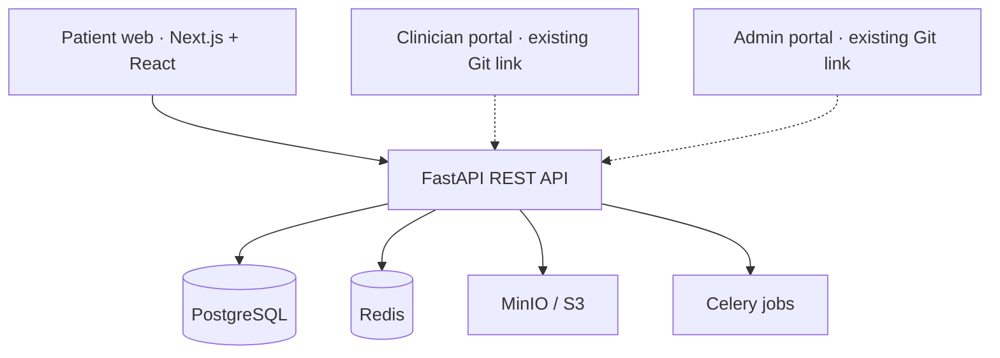

<div align="center">

# CareConnect

### Healthcare connections, made simpler.

**A modern, responsive telehealth web platform for discovering clinicians, booking consultations, and managing care.**


[Overview](#overview) · [Features](#features) · [Get started](#getting-started) · [Architecture](#architecture) · [Roadmap](#roadmap)

</div>

---

> [!IMPORTANT]
> **Development prototype only.** CareConnect must not be used with real medical records or personal health information. Patient verification, clinical eligibility, consent, authorization, secure integrations, tests and regulatory assessment are still required. This project is **not** certified as HIPAA compliant.

## Overview

CareConnect brings healthcare access into one simple web interface. Patients can find clinicians, explore available visit times, and manage appointments from their browser—on a desktop, tablet, or phone.

**Web-first scope:** The current product targets responsive browser experiences. Native iOS/Android applications are intentionally out of scope.

## Features

| Experience | Current state |
| --- | --- |
| Responsive home page and navigation | Implemented in Next.js |
| Clinician directory, search and specialty filters | Implemented in web UI and wired to FastAPI |
| Clinician detail and appointment availability | Implemented in web UI and wired to FastAPI |
| Appointment hold and booking | Client + API integration written; needs E2E and concurrency verification |
| Patient registration, sign-in and sign-out | Client + API integration written; identity and consent validation pending |
| Patient appointments | Authenticated UI and API integration written |
| Secure messaging, records, prescriptions, video | Backend modules exist; web features not completed |
| Clinician and admin portals | Existing Git links; source and behavior require verification |
| Production readiness | Not ready for clinical deployment |

The interface uses deep navy typography, teal accents, soft surfaces, accessible controls and responsive grids. No fake clinician reviews, credentials or availability are inserted into API results.

## Architecture



## Technology stack

| Layer | Tools |
| --- | --- |
| Web client | Next.js 15, React 19, TypeScript, CSS, Lucide icons |
| Backend | Python, FastAPI, Pydantic, SQLAlchemy |
| Persistence | PostgreSQL, Alembic |
| Jobs and cache | Celery, Redis |
| Local infrastructure | Docker Compose, MinIO, MailHog |

### Repository layout

```text
apps/
  patient-web/         # Responsive Next.js web portal
    app/               # Page, layout and design system CSS
    lib/api.ts         # Typed FastAPI client
  clinician-web/       # Existing Git link; not verified
  admin-web/           # Existing Git link; not verified
services/
  api/                 # FastAPI routes, models, services, migrations
  worker/              # Background tasks
infra/
  docker-compose.yml   # Local development services
docs/
  IMPLEMENTATION_STATUS.md
```

## Getting started

### Prerequisites

- Node.js 20+
- npm
- Docker Engine and Docker Compose

### 1. Clone and configure

```bash
git clone https://github.com/Gech-E/CareConnect-.git
cd CareConnect-
cp services/api/.env.example services/api/.env
```

Use only development secrets and synthetic data. For PowerShell, replace `cp` with `Copy-Item`.

### 2. Start backend services

```bash
docker compose -f infra/docker-compose.yml up --build -d
docker compose -f infra/docker-compose.yml exec api alembic upgrade head
```

FastAPI runs at **http://localhost:8005** and local API documentation at **http://localhost:8005/docs**.

### 3. Run the web app

```bash
cd apps/patient-web
cp .env.example .env.local
npm install
npm run dev
```

Open **http://localhost:3005**.

The web app expects `NEXT_PUBLIC_CARECONNECT_API_URL=http://localhost:8005/api/v1` by default. For staging and production, use HTTPS and configure approved CORS origins.

### 4. Verify your changes

```bash
cd apps/patient-web
npm run typecheck
npm run build
```

These are verification commands, **not** a claim that CI or runtime integration tests have passed. The API and appointment flow still require end-to-end testing.

## Security considerations

- No real patient data, passwords, or secrets in fixtures or Git.
- Browser authentication currently uses **memory-only bearer tokens**, which expire from the UI on refresh. For production, replace this with an audited backend-for-frontend approach using secure HttpOnly cookies and CSRF defenses.
- Complete patient email verification and telehealth consent before protected clinical data access.
- Audit every privileged operation; enforce server-side authorization and clinician licensing/service-area checks.
- Add strong slot-conflict prevention at the database layer.
- Implement rate limits, token rotation, data-retention policy, security review and incident response.
- Do not claim HIPAA compliance until all required technical and organizational controls are validated.

## Roadmap

- [x] Responsive Next.js patient experience
- [x] FastAPI client and clinician discovery integration
- [x] Basic appointment selection and booking UI
- [ ] Verify and stabilize auth, consent, and account sessions
- [ ] End-to-end booking, cancellation and rescheduling
- [ ] Messaging, records and prescriptions web experiences
- [ ] Clinician and administrator web dashboards
- [ ] Accessibility, integration and security tests
- [ ] Production deployment validation and operational controls

## Documentation

- [Product Requirements](./CareConnect_PRD_v1.0.md)
- [Software Requirements Specification](./CareConnect_SRS_v1.0.md)
- [Implementation status](./docs/IMPLEMENTATION_STATUS.md)

## Contributing

Use focused pull requests, describe the user-facing changes, include tests for business rules, and never include real patient information. This repository does not currently declare an open-source license.

---

<div align="center">

**CareConnect** · Better access to care, thoughtfully built.

</div>
