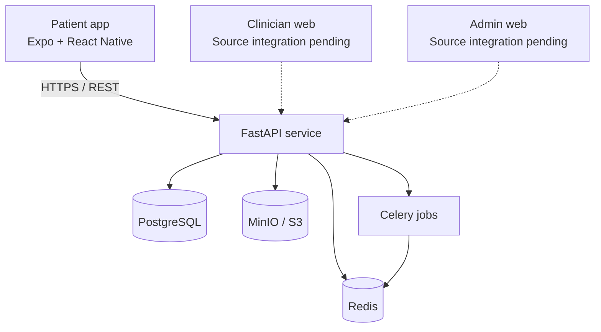

<div align="center">

# CareConnect

### Healthcare connections, made simpler.

**A patient-centered telehealth platform for discovering clinicians, scheduling virtual visits, and managing care.**

[](#project-status)
[](#technology-stack)
[](#technology-stack)
[](#technology-stack)

[Overview](#overview) · [Features](#features--project-status) · [Quick start](#getting-started) · [Architecture](#architecture) · [Roadmap](#roadmap)

</div>

---

> [!IMPORTANT]
> **Development prototype — not for clinical use.** CareConnect is not verified for handling real patient health information or providing clinical services. Identity verification, clinician eligibility, consent, security, availability, and regulatory requirements must be completed and independently assessed before any production launch. Use **synthetic data only** during development.

## Overview

**CareConnect** brings the essential steps of accessing virtual healthcare into a calm, approachable experience. Patients can explore a clinician directory, review profiles, find appointment times, and manage upcoming visits from a mobile application.

The project is organized around three intended user experiences:

- **Patients** — discover clinicians, book consultations, and manage care.
- **Clinicians** — manage availability, appointments, and encounters.
- **Administrators** — support operations, clinician oversight, and audit workflows.

The product vision, priorities, functional requirements, and acceptance criteria are captured in the [Product Requirements Document](./CareConnect_PRD_v1.0.md) and [Software Requirements Specification](./CareConnect_SRS_v1.0.md).

## Features & project status

Features below distinguish **source that exists** from functionality that still needs complete integration and testing.

| Area | Current state | Notes |
| --- | --- | --- |
| Patient home and navigation | **Implemented in mobile client** | Home, clinician search, visits, and account screens |
| Clinician directory and profiles | **Mobile + API integration written** | Search and specialty filtering; server-side clinical eligibility needs verification |
| Appointment availability and booking | **Mobile + API integration written** | Slot lookup, hold, and confirmation; concurrency and workflow tests are required |
| Patient sign-in and registration | **Mobile + API integration written** | Patient-only self-registration; identity verification and full session lifecycle are pending |
| Appointment list | **Mobile + API integration written** | Authenticated patient appointment retrieval |
| Patient profile and insurance | **Backend endpoints present** | Complete patient UI and end-to-end validation still needed |
| Messaging, records, prescriptions | **Backend modules present** | Patient-facing integration and authorization review needed |
| Video consultation | **Backend integration scaffolding present** | Secure production video and device readiness not delivered |
| Clinician and admin portals | **Not validated in this repository** | Existing directories are Git links; inspect source repositories before claiming readiness |
| Automated quality gates | **In progress** | Initial auth tests added; full CI, E2E, accessibility and security testing outstanding |

**Status:** Active development. Features described as implemented have code in the repository; that designation does **not** mean they have passed integration, security, or device testing.

## Design approach

The patient experience follows a focused, accessible interface system:

- **Clear hierarchy** with simple navigation and obvious next actions.
- **Calm visual language** using soft off-white surfaces, slate text, and teal accents.
- **Consistent components** for cards, buttons, search, selection, and status feedback.
- **Responsive interaction states** for loading, empty results, sign-in requirements, and API errors.
- **Privacy-aware defaults** that avoid fabricated doctor credentials and unnecessary exposure of patient information.

The current interface is an initial implementation; WCAG 2.2 AA testing and usability validation are still required.

## Technology stack

| Layer | Technology |
| --- | --- |
| Patient application | React Native, Expo, TypeScript |
| API | Python, FastAPI, Pydantic |
| Database and migrations | PostgreSQL, SQLAlchemy, Alembic |
| Background processing | Redis, Celery |
| File storage (local) | MinIO, S3-compatible API |
| Infrastructure | Docker Compose |
| Testing and code quality | pytest, Ruff, mypy, TypeScript checks (coverage incomplete) |

## Architecture



### Repository structure

```text
CareConnect-/
├── apps/
│   ├── patient-mobile/        # Expo patient application
│   │   ├── App.tsx            # Patient screens and navigation
│   │   └── src/api.ts         # Typed FastAPI client
│   ├── clinician-web/         # Git link; source integration pending
│   └── admin-web/             # Git link; source integration pending
├── services/
│   ├── api/                   # FastAPI routes, services, models, migrations
│   └── worker/                # Background-task service
├── infra/
│   └── docker-compose.yml     # Local development services
├── docs/
│   └── IMPLEMENTATION_STATUS.md
├── CareConnect_PRD_v1.0.md
└── CareConnect_SRS_v1.0.md
```

## Getting started

### Prerequisites

- Docker Engine and Docker Compose
- Node.js and npm
- Expo Go or an Android/iOS simulator for mobile development
- Python 3.11+ if running the API or tests outside Docker

### 1. Clone the repository

```bash
git clone https://github.com/Gech-E/CareConnect-.git
cd CareConnect-
```

> To try the new patient app and the changes documented here, switch to the feature branch:
>
> ```bash
> git switch feat/patient-experience-and-security-foundation
> ```

### 2. Configure the backend

Copy the example environment file and review the **local-only** configuration:

```bash
cp services/api/.env.example services/api/.env
```

On Windows PowerShell, use `Copy-Item services/api/.env.example services/api/.env`.

Replace the example secrets for your development environment. Do not commit `.env` files or reuse local credentials in staging or production.

### 3. Start local services

```bash
docker compose -f infra/docker-compose.yml up --build -d
docker compose -f infra/docker-compose.yml exec api alembic upgrade head
```

The local stack defines these development endpoints:

| Service | Local address |
| --- | --- |
| FastAPI | `http://localhost:8005` |
| API documentation | `http://localhost:8005/docs` |
| PostgreSQL | `localhost:5433` |
| Redis | `localhost:6380` |
| MinIO console | `http://localhost:9001` |
| MailHog | `http://localhost:8025` |

Use only synthetic fixtures. Review `services/api/seed.py` before running any seed command.

### 4. Run the patient application

```bash
cd apps/patient-mobile
npm install
```

Copy `.env.example` to `.env` in the **patient-mobile** directory. Set `EXPO_PUBLIC_API_URL` according to your device:

| Runtime | API base URL |
| --- | --- |
| iOS simulator | `http://localhost:8005/api/v1` |
| Android emulator | `http://10.0.2.2:8005/api/v1` |
| Physical device | `http://<your-computer-LAN-IP>:8005/api/v1` |

For a physical device, the API must be reachable from the same trusted local network. Local HTTP is for development only; deployed applications must use HTTPS.

```bash
npm start
```

Open the project using Expo Go or your preferred emulator. The local stack and mobile app have not yet passed a complete end-to-end startup verification.

### 5. Development checks

Run the mobile TypeScript check:

```bash
cd apps/patient-mobile
npm run typecheck
```

For API tests and linting, use a Python environment with development dependencies installed:

```bash
cd services/api
python -m pip install -e ".[dev]"
python -m pytest
ruff check app tests
```

These commands are **recommended verification steps**, not a claim that the current build or test suite passes.

## API overview

The API uses the `/api/v1` prefix. Representative routes include:

| Method | Endpoint | Purpose |
| --- | --- | --- |
| `POST` | `/auth/register` | Patient self-registration |
| `POST` | `/auth/login` | Authenticate a user |
| `GET` | `/specialties` | Browse specialties |
| `GET` | `/practitioners` | Search clinician directory |
| `GET` | `/practitioners/{id}/availability` | Retrieve available slots |
| `POST` | `/appointment-holds` | Create a temporary hold |
| `POST` | `/appointments` | Confirm an appointment |
| `GET` | `/appointments` | List a patient's appointments |

See `/docs` when the local API is running for the generated OpenAPI reference. Contract correctness and authorization behavior still require integration testing.

## Security & privacy

CareConnect handles a sensitive domain; protecting patient information is a prerequisite, not a future polish item.

- Do not store real protected health information in development databases, logs, screenshots, test fixtures, or analytics.
- Keep credentials outside version control and rotate any real secrets previously committed.
- Restrict public registration to patient accounts; provision workforce identities separately.
- Validate access-token type and session state on protected requests; implement refresh rotation, verification, audit coverage, and comprehensive authorization before production.
- Enforce clinician credential/service-area checks, verified consent, object-level access controls, secure document handling, and appointment concurrency safeguards.
- Complete threat modeling, penetration testing, incident-response planning, and legal/regulatory assessment.

**No HIPAA-compliance certification or clinical safety claim is made.** Technical architecture alone does not establish regulatory compliance.

## Roadmap

- [x] Establish backend API and domain modules
- [x] Create initial patient mobile experience
- [x] Integrate clinician discovery and booking requests
- [x] Add patient-only registration and initial token/session hardening
- [ ] Verify patient identity, consent, and profile completion
- [ ] Fix concurrency guarantees and appointment state transitions
- [ ] Complete messaging, records, prescriptions, and video experiences
- [ ] Integrate and validate clinician/admin portals
- [ ] Build CI pipelines and end-to-end regression tests
- [ ] Complete accessibility, privacy, and security reviews
- [ ] Validate deployment and monitoring for an approved clinical environment

For detailed gaps and delivery gates, see [Implementation Status](./docs/IMPLEMENTATION_STATUS.md).

## Project documentation

- [Product Requirements Document (PRD)](./CareConnect_PRD_v1.0.md)
- [Software Requirements Specification (SRS)](./CareConnect_SRS_v1.0.md)
- [Implementation Status & Risks](./docs/IMPLEMENTATION_STATUS.md)
- [Patient App Setup](./apps/patient-mobile/README.md)

## Contributing

Contributions are welcome through issues and pull requests. Please keep changes small, explain their effect on patient data and authorization, add appropriate tests, and reference relevant PRD/SRS requirements. Do not include secrets or real patient data.

This repository does not currently declare a license; contact the repository owner before assuming permission to redistribute or commercially reuse the source.

---

<div align="center">

**CareConnect** · A simpler path to connected care

*Built with a focus on clarity, accessibility, and responsible engineering.*

</div>
